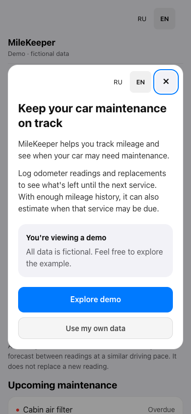
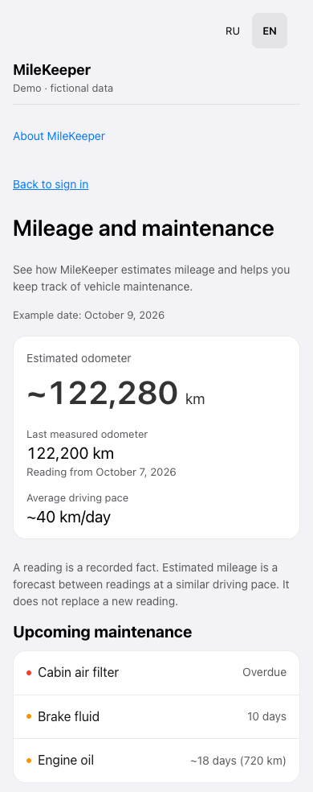
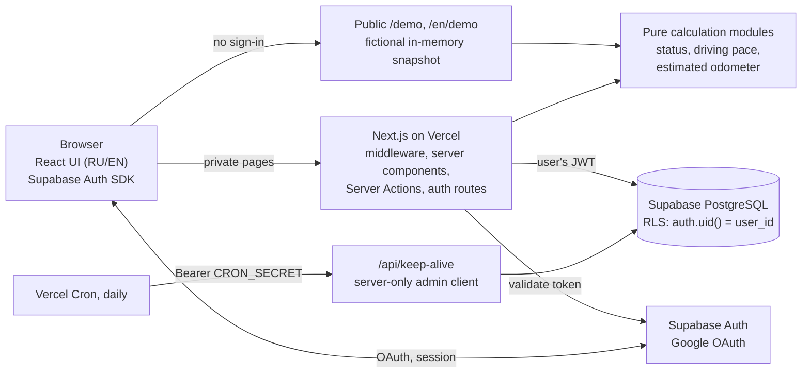

# MileKeeper

[English](README.md) · [Русский](README.ru.md)

MileKeeper keeps a car's maintenance on schedule. You record odometer readings and replacements; the app tracks every maintenance item against its mileage or calendar interval, estimates the current mileage between readings and forecasts when each service will be due.

**Try the demo — no sign-up, fictional data:** [English](https://milekeeper.vercel.app/en/demo) · [Russian](https://milekeeper.vercel.app/demo)<br>
**Application:** [milekeeper.vercel.app](https://milekeeper.vercel.app/) — Google sign-in, your own records

<p>
  
  &nbsp;
  
</p>

A personal project built with AI coding agents. I defined the tasks, designed the product logic, managed the AI-driven development, tested and verified the results and released the product; a significant part of the code was written by the agents. See [How it was built](#how-it-was-built).

## The problem

Maintenance intervals come in two kinds: "every 10,000 km" and "every 2 years". Calendar dates are easy to track, mileage is not: odometer readings are sparse, so drivers either keep spreadsheets or miss services. MileKeeper keeps both kinds of intervals in one place and turns occasional readings into a forecast: at your recent driving pace, when will the next 10,000 km run out?

## Features

- Odometer readings with date and optional note; edit or delete the latest one.
- Maintenance items with a mileage or calendar interval and a warning threshold.
- Replacement history per item and a breakdown of how its status was calculated.
- Status for every item — OK, due soon, overdue or not enough data — with remaining kilometres or days.
- Estimated current mileage and day-based forecasts from the recent driving pace. Estimates are computed on read and never stored as readings.
- Russian and English UI, phone and desktop layouts, installable web app manifest.
- Public read-only demo and a getting-started checklist for an empty account.

Not included: several vehicles per account, fleet management, push or email reminders, offline sync. Warnings are shown inside the app.

## Architecture



| Layer | Implementation |
| --- | --- |
| Application | Next.js 16 (App Router, Server Actions, middleware), React 19, TypeScript |
| Data and sign-in | Supabase PostgreSQL, Supabase Auth with Google OAuth |
| Access control | Row Level Security on every user table. User-facing code queries with the signed-in user's JWT; the service-role key is used only by the keep-alive endpoint |
| Hosting | Vercel. A daily Vercel Cron call keeps the free-tier Supabase project active |
| Quality | Vitest, browser regression scripts on Playwright and Chrome, SQL tests on a disposable PostgreSQL, ESLint, GitHub Actions |

### Engineering decisions

- **Ownership is enforced in the database.** RLS policies check `auth.uid() = user_id` on reads and writes, and a composite foreign key stops a service event from pointing at another user's item. 45 SQL assertions cover anonymous access, cross-user writes and a migration rollback on inconsistent legacy data. [Database security](docs/database-security-stage-1.md)
- **Facts and forecasts stay separate.** Status, driving-pace and odometer-estimate logic lives in pure modules that receive the current time explicitly, so tests can pin any date. The public demo runs the same functions on a fictional snapshot without touching the database. [Calculation spec](docs/calculations/mileage-and-forecast-to-be.md)
- **Sessions survive mobile edge cases.** Server renders validate the access token without refreshing it; the browser SDK session and HttpOnly server cookies are kept in sync through dedicated routes; a recovery flow tells an invalid session from a network failure and keeps unsaved form input. [Mobile session recovery](docs/mobile-auth-recovery-2026-10-12.md)
- **Security hardening before publishing the code.** Next.js 16.1 → 16.3 closed 38 published framework advisories; developer-only Server Actions are refused on the server outside development; the keep-alive endpoint rejects a missing secret and compares tokens in constant time; the service-role client sits behind a `server-only` boundary. [Report](docs/security-hardening-2026-10-15.md)

## Quality and verification

CI ([`.github/workflows/ci.yml`](.github/workflows/ci.yml)) runs on every push and pull request with a read-only token, no secrets and no deployment steps. Results of the same commands on 16 October 2026:

| Check | Result |
| --- | --- |
| Type check of the whole project, tests included (`npm run typecheck`) | 0 errors |
| Lint (`npm run lint`, Next.js ESLint config) | 0 errors; 87 warnings tracked (React Compiler advisories, unused variables, legacy `any`) |
| Unit, component and route tests (`npm test`), under UTC and UTC+5 | 516 passed |
| Production build (`npm run build`) | passes |
| Database security tests on a disposable PostgreSQL 16 | 45 assertions passed |
| Production dependency audit (`npm audit --omit=dev`) | 0 known vulnerabilities |
| Browser regressions, run locally against a local Supabase fixture: session recovery, RU/EN flows, demo hydration, onboarding | 33/33, 24/24, 20/20, 3 of 3 runs |

Not automated: real Google OAuth, Safari on iOS and the installed PWA. They are accepted manually on a real phone after each release. Development-only audit findings remain in Vitest 1.x and in `braces`, which `eslint-config-next` pulls in and which has no fixed release; neither is part of the production bundle.

## Release process

- Work happens on feature branches. A production release is built from a reviewed commit with the Vercel CLI as a staged deployment without the domain, smoke-tested, then promoted. The previous deployment stays ready for an instant rollback.
- Pushing to `main` does not deploy: [`vercel.json`](vercel.json) turns off Git deployments for that branch, so production changes only through the staged CLI release.
- Each step — branch push, preview, production promotion, updating `main` — is approved separately.
- Releases and investigations are recorded as dated documents in [`docs/`](docs/README.md) (mostly in Russian).

Example: on 9 October 2026 a release broke the Google sign-in callback. The site was rolled back to the previous deployment; the cause — the browser sent the whole SDK session object to a sync endpoint that strictly validates its input — was fixed with regression tests and re-released as a staged deployment after manual acceptance. [Incident record](docs/auth-sync-incident-2026-10-09.md)

## How it was built

MileKeeper is an exercise in shipping a real web app with AI coding agents while keeping product, security and release decisions with a human. A significant part of the code was written by AI agents; I do not present it as hand-written.

My part:

- **Defining tasks** — the problem, the scope and the acceptance criteria for each stage.
- **Designing the logic** — rules for maintenance status, driving pace and forecasts with their edge cases; requirements for data ownership and security.
- **Managing AI development** — splitting work into staged tasks with explicit constraints, directing the agents, asking for root causes and for tests that fail on the old code, choosing trade-offs.
- **Testing and verifying results** — reviewing the agents' changes and reports, reading automated results critically, manual acceptance on real devices: Google sign-in, Safari on iPhone, the installed PWA.
- **Releasing the product** — staged deployments, smoke checks, rollback targets and a separate approval for every step.

Tools:

- **ChatGPT** — product and requirement discussions, specification drafts and task descriptions for the coding agents.
- **Codex** — implementation and verification of the October 2026 stages: database security, session security, English localization, the public demo and onboarding, mobile session recovery (`codex/*` branches in the dated reports).
- **Claude Code** — estimated mileage, performance and session-race fixes and the PWA manifest (September 2026); the security-hardening release and this public-repository preparation (October 2026). These commits carry a `Co-Authored-By: Claude` trailer.

The application itself has no AI features.

## Run it locally

Requires Node.js 24 (see `.nvmrc`) and npm.

```bash
npm ci
cp .env.example .env.local
npm run dev
```

Open [localhost:3001/en/demo](http://localhost:3001/en/demo) or [localhost:3001/demo](http://localhost:3001/demo). The placeholders in `.env.example` are enough for the demo, not for signing in.

To sign in locally, create your own Supabase development project with the Google provider, apply [`supabase/migrations`](supabase/migrations) in filename order and put that project's URL and publishable (anon) key into the four `*_SUPABASE_*` variables of `.env.local`. Set the Supabase Site URL to `http://localhost:3001` and allow `http://localhost:3001/auth/callback`. Details and caveats: [`supabase/README.md`](supabase/README.md). Never put a service-role or secret key into a `NEXT_PUBLIC_*` variable; `SUPABASE_SERVICE_ROLE_KEY` and `CRON_SECRET` are needed only for the keep-alive endpoint and can stay empty.

### Checks

```bash
npm run typecheck              # tsc over the whole project
npm run lint                   # ESLint
npm test                       # Vitest
npm run build                  # production build
npm run test:db-security       # disposable local PostgreSQL; never connects to Supabase
```

The database tests need PostgreSQL binaries (`initdb`, `pg_ctl`, `psql`); set `PG_BIN=/path/to/postgresql/bin` if they are not found. They create and remove their own socket-only cluster.

The browser scripts mock the identity provider, run a local Supabase fixture and need Google Chrome plus Playwright installed outside the project:

```bash
npm install --prefix /tmp/milekeeper-browser-tools --no-save playwright
export MILEKEEPER_PLAYWRIGHT_PATH=/tmp/milekeeper-browser-tools/node_modules/playwright
npm run test:demo:hydration
npm run test:auth-recovery:browser
npm run test:i18n:browser
npm run test:onboarding:browser
```

Run them one at a time: they share ports 3101 and 54329. The onboarding script has a known intermittent race in the test itself (it clears cookies while a session sync request may still be in flight); see section 8 of the [security-hardening report](docs/security-hardening-2026-10-15.md).

## Repository map

| Path | What is there |
| --- | --- |
| [`src/app`](src/app) | Pages, UI components, API routes, public demo |
| [`src/lib/service`](src/lib/service) | Maintenance status, driving pace, estimated odometer |
| [`src/lib/auth`](src/lib/auth), [`src/lib/supabase`](src/lib/supabase) | Session sync and recovery, Supabase clients, auth cookies |
| [`src/lib/actions`](src/lib/actions) | User-scoped reads and mutations (Server Actions) |
| [`src/lib/demo`](src/lib/demo), [`src/lib/i18n`](src/lib/i18n) | Fictional demo snapshot, RU/EN dictionaries and routing |
| [`supabase`](supabase) | SQL migrations and database security tests |
| [`scripts`](scripts) | Browser regression scripts and the database test runner |
| [`docs`](docs/README.md) | Specifications, release records and investigations |

## Author and license

Created by [Stanislav Khreshchik](https://github.com/hreshchicstanislav-debug).

The repository is published as a portfolio, not as open-source software. `package.json` declares `"license": "UNLICENSED"` and there is no `LICENSE` file, so no license to reuse the code is granted and all rights are reserved. The `"private": true` flag next to it only prevents publishing the package to npm; it says nothing about the repository's visibility on GitHub.
