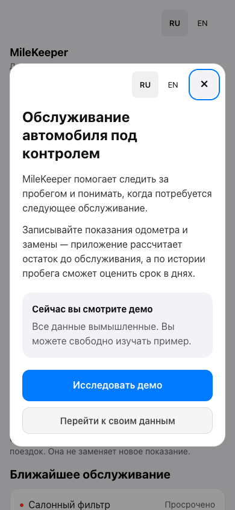
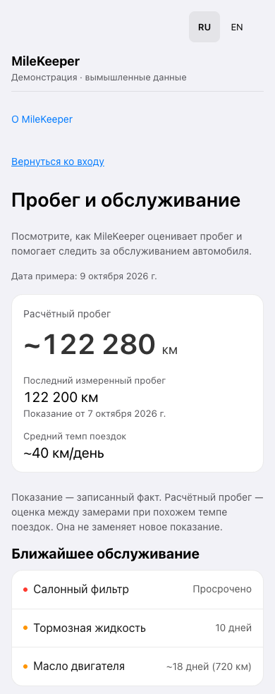
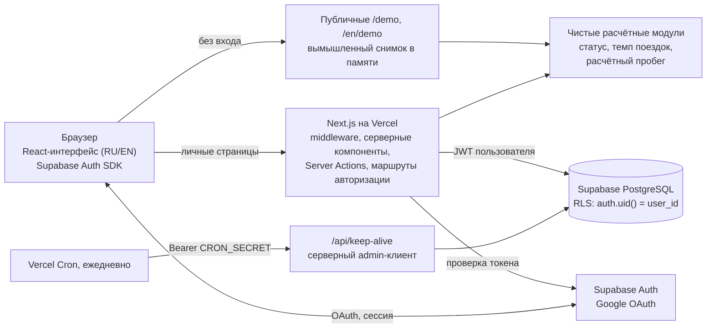

# MileKeeper

[English](README.md) · [Русский](README.ru.md)

MileKeeper помогает не пропускать обслуживание автомобиля. Вы записываете показания одометра и замены; приложение следит за каждым элементом обслуживания по интервалу пробега или календаря, оценивает текущий пробег между показаниями и прогнозирует, когда понадобится следующее обслуживание.

**Демо без регистрации, вымышленные данные:** [на русском](https://milekeeper.vercel.app/demo) · [на английском](https://milekeeper.vercel.app/en/demo)<br>
**Приложение:** [milekeeper.vercel.app](https://milekeeper.vercel.app/) — вход через Google, ваши собственные записи

<p>
  
  &nbsp;
  
</p>

Личный проект, созданный с помощью AI-агентов для программирования. Я ставил задачи, проектировал логику, управлял AI-разработкой, тестировал и проверял результаты и выпускал продукт; значительную часть кода написали AI-агенты. Подробнее — в разделе [Как создавался проект](#как-создавался-проект).

## Какую проблему решает

Интервалы обслуживания бывают двух видов: «каждые 10 000 км» и «раз в 2 года». За календарём следить легко, за пробегом — нет: показания одометра записываются редко, поэтому владельцы ведут таблицы или пропускают обслуживание. MileKeeper хранит оба вида интервалов в одном месте и превращает редкие показания в прогноз: при нынешнем темпе поездок когда закончатся следующие 10 000 км?

## Возможности

- Показания одометра с датой и необязательной заметкой; редактирование и удаление последнего показания.
- Элементы обслуживания с интервалом по пробегу или календарю и порогом предупреждения.
- История замен по каждому элементу и разбор того, как рассчитан его статус.
- Статус каждого элемента — в норме, скоро, просрочено или недостаточно данных — с остатком в километрах или днях.
- Расчётный текущий пробег и прогноз в днях по недавнему темпу поездок. Оценка вычисляется при чтении и никогда не сохраняется как показание.
- Интерфейс на русском и английском, раскладка для телефона и компьютера, манифест устанавливаемого веб-приложения.
- Публичное демо только для просмотра и подсказки первых шагов в пустом аккаунте.

Нет в продукте: нескольких автомобилей в одном аккаунте, управления автопарком, push- и email-напоминаний, офлайн-синхронизации. Предупреждения показываются внутри приложения.

## Архитектура



| Слой | Реализация |
| --- | --- |
| Приложение | Next.js 16 (App Router, Server Actions, middleware), React 19, TypeScript |
| Данные и вход | Supabase PostgreSQL, Supabase Auth с Google OAuth |
| Контроль доступа | Row Level Security на всех пользовательских таблицах. Пользовательский код обращается к БД с JWT вошедшего пользователя; ключ service role использует только keep-alive endpoint |
| Размещение | Vercel. Ежедневный вызов Vercel Cron не даёт бесплатному проекту Supabase уснуть |
| Качество | Vitest, браузерные регрессионные сценарии на Playwright и Chrome, SQL-тесты на временном PostgreSQL, ESLint, GitHub Actions |

### Инженерные решения

- **Владение данными обеспечивает сама БД.** Политики RLS проверяют `auth.uid() = user_id` при чтении и записи, а составной внешний ключ не позволяет привязать событие обслуживания к элементу другого пользователя. 45 SQL-проверок охватывают анонимный доступ, запись в чужие данные и откат миграции на противоречивых исторических данных. [Безопасность БД](docs/database-security-stage-1.md)
- **Факты и прогнозы разделены.** Логика статуса, темпа поездок и расчётного пробега — в чистых модулях, которые получают текущее время явно, поэтому тесты фиксируют любую дату. Публичное демо вызывает те же функции на вымышленном снимке, не обращаясь к БД. [Спецификация расчётов](docs/calculations/mileage-and-forecast-to-be.md)
- **Сессии переживают мобильные сценарии.** Серверный рендер проверяет access token, не обновляя его; сессия браузерного SDK и HttpOnly-cookie сервера синхронизируются через отдельные маршруты; сценарий восстановления отличает недействительную сессию от сбоя сети и сохраняет несохранённые данные формы. [Восстановление мобильных сессий](docs/mobile-auth-recovery-2026-10-12.md)
- **Усиление безопасности перед публикацией кода.** Обновление Next.js 16.1 → 16.3 закрыло 38 опубликованных уязвимостей фреймворка; dev-действия Server Actions отклоняются на сервере вне режима разработки; keep-alive отклоняет запрос без настроенного секрета и сравнивает токены за постоянное время; admin-клиент с ключом service role отделён границей `server-only`. [Отчёт](docs/security-hardening-2026-10-15.md)

## Качество и проверки

CI ([`.github/workflows/ci.yml`](.github/workflows/ci.yml)) запускается на каждый push и pull request: токен только для чтения, без секретов и без шагов деплоя. Результаты тех же команд на 16 октября 2026 года:

| Проверка | Результат |
| --- | --- |
| Проверка типов всего проекта вместе с тестами (`npm run typecheck`) | 0 ошибок |
| Lint (`npm run lint`, конфигурация ESLint от Next.js) | 0 ошибок; 87 предупреждений на учёте (правила React Compiler, неиспользуемые переменные, старые `any`) |
| Unit-, компонентные и маршрутные тесты (`npm test`) в UTC и UTC+5 | 516 пройдено |
| Production-сборка (`npm run build`) | проходит |
| Тесты безопасности БД на временном PostgreSQL 16 | 45 проверок пройдено |
| Аудит production-зависимостей (`npm audit --omit=dev`) | 0 известных уязвимостей |
| Браузерные регрессии локально с локальной фикстурой Supabase: восстановление сессий, сценарии RU/EN, гидратация демо, onboarding | 33/33, 24/24, 20/20, 3 из 3 прогонов |

Не автоматизированы: настоящий Google OAuth, Safari на iOS и установленная PWA — их принимаю вручную на реальном телефоне после каждого релиза. В dev-зависимостях остаются находки аудита: Vitest 1.x и пакет `braces`, который приносит `eslint-config-next` и для которого исправленной версии нет; в production-сборку они не попадают.

## Процесс релизов

- Работа ведётся в feature-ветках. Production-релиз собирается из проверенного коммита через Vercel CLI как staged-деплой без домена, проходит smoke-проверку и затем продвигается на основной домен. Предыдущий деплой остаётся готовым к мгновенному откату.
- Push в `main` не запускает деплой: [`vercel.json`](vercel.json) отключает Git-деплои для этой ветки, поэтому production меняется только через staged-релиз из CLI.
- Каждый шаг — push ветки, preview, продвижение в production, обновление `main` — согласуется отдельно.
- Релизы и расследования записаны в датированных документах в [`docs/`](docs/README.md).

Пример: 9 октября 2026 года релиз сломал callback входа через Google. Сайт откатили на предыдущий деплой; причину — браузер отправлял целиком объект сессии SDK в маршрут синхронизации со строгой проверкой входных данных — исправили с регрессионными тестами и выпустили повторно через staged-деплой после ручной приёмки. [Запись об инциденте](docs/auth-sync-incident-2026-10-09.md)

## Как создавался проект

MileKeeper — опыт создания настоящего веб-приложения с AI-агентами, при котором решения о продукте, безопасности и релизах остаются за человеком. Значительная часть кода написана AI-агентами; я не выдаю её за написанную вручную.

Моя часть работы:

- **Постановка задач** — проблема, границы продукта и критерии приёмки каждого этапа.
- **Проектирование логики** — правила расчёта статуса обслуживания, темпа поездок и прогнозов с граничными случаями; требования к владению данными и безопасности.
- **Управление AI-разработкой** — разбиение работы на этапы с явными ограничениями, постановка задач агентам, требование найти первопричину и написать тесты, падающие на старом коде, выбор компромиссов.
- **Тестирование и проверка результатов** — проверка изменений и отчётов агентов, критическая оценка автоматических проверок, ручная приёмка на реальных устройствах: вход через Google, Safari на iPhone, установленная PWA.
- **Выпуск продукта** — staged-деплои, smoke-проверки, цели для отката и отдельное согласование каждого шага.

Инструменты:

- **ChatGPT** — обсуждение продукта и требований, черновики спецификаций и постановки задач для агентов.
- **Codex** — реализация и проверка этапов октября 2026 года: безопасность БД, безопасность сессий, английская локализация, публичное демо и onboarding, восстановление мобильных сессий (ветки `codex/*` в датированных отчётах).
- **Claude Code** — расчётный пробег, исправления производительности и гонки сессий, манифест PWA (сентябрь 2026); релиз усиления безопасности и подготовка этого публичного репозитория (октябрь 2026). У этих коммитов есть трейлер `Co-Authored-By: Claude`.

Самих AI-функций в приложении нет.

## Локальный запуск

Нужны Node.js 24 (см. `.nvmrc`) и npm.

```bash
npm ci
cp .env.example .env.local
npm run dev
```

Откройте [localhost:3001/demo](http://localhost:3001/demo) или [localhost:3001/en/demo](http://localhost:3001/en/demo). Заглушек из `.env.example` достаточно для демо, но не для входа.

Для локального входа создайте собственный development-проект Supabase с провайдером Google, примените [`supabase/migrations`](supabase/migrations) в порядке имён файлов и укажите URL и publishable (anon) key этого проекта в четырёх переменных `*_SUPABASE_*` файла `.env.local`. Задайте в Supabase Site URL `http://localhost:3001` и разрешите `http://localhost:3001/auth/callback`. Подробности и ограничения — в [`supabase/README.md`](supabase/README.md). Никогда не помещайте service-role или secret key в переменные `NEXT_PUBLIC_*`; `SUPABASE_SERVICE_ROLE_KEY` и `CRON_SECRET` нужны только для keep-alive и могут оставаться пустыми.

### Проверки

```bash
npm run typecheck              # tsc по всему проекту
npm run lint                   # ESLint
npm test                       # Vitest
npm run build                  # production-сборка
npm run test:db-security       # временный локальный PostgreSQL; к Supabase не подключается
```

Тестам БД нужны бинарные файлы PostgreSQL (`initdb`, `pg_ctl`, `psql`); если они не найдены, задайте `PG_BIN=/path/to/postgresql/bin`. Скрипт сам создаёт и удаляет кластер, доступный только через Unix-сокет.

Браузерные сценарии подменяют провайдера входа, поднимают локальную фикстуру Supabase и требуют Google Chrome и Playwright, установленный вне проекта:

```bash
npm install --prefix /tmp/milekeeper-browser-tools --no-save playwright
export MILEKEEPER_PLAYWRIGHT_PATH=/tmp/milekeeper-browser-tools/node_modules/playwright
npm run test:demo:hydration
npm run test:auth-recovery:browser
npm run test:i18n:browser
npm run test:onboarding:browser
```

Запускайте их по одному: они используют общие порты 3101 и 54329. В onboarding-сценарии есть известная плавающая гонка в самом тесте (он очищает cookies, пока может выполняться запрос синхронизации сессии); см. раздел 8 [отчёта об усилении безопасности](docs/security-hardening-2026-10-15.md).

## Карта репозитория

| Путь | Что там |
| --- | --- |
| [`src/app`](src/app) | Страницы, компоненты интерфейса, API-маршруты, публичное демо |
| [`src/lib/service`](src/lib/service) | Статус обслуживания, темп поездок, расчётный пробег |
| [`src/lib/auth`](src/lib/auth), [`src/lib/supabase`](src/lib/supabase) | Синхронизация и восстановление сессий, клиенты Supabase, auth-cookie |
| [`src/lib/actions`](src/lib/actions) | Чтение и изменение данных пользователя (Server Actions) |
| [`src/lib/demo`](src/lib/demo), [`src/lib/i18n`](src/lib/i18n) | Вымышленный снимок демо, словари и маршрутизация RU/EN |
| [`supabase`](supabase) | SQL-миграции и тесты безопасности БД |
| [`scripts`](scripts) | Браузерные регрессионные сценарии и запуск тестов БД |
| [`docs`](docs/README.md) | Спецификации, записи о релизах и расследования |

## Автор и лицензия

Автор — [Станислав Хрещик](https://github.com/hreshchicstanislav-debug).

Репозиторий опубликован как портфолио, а не как open-source проект. В `package.json` указано `"license": "UNLICENSED"`, файла `LICENSE` нет: право на повторное использование кода не предоставляется, все права сохраняются за автором. Флаг `"private": true` там же лишь запрещает публикацию пакета в npm и никак не связан с видимостью репозитория на GitHub.
